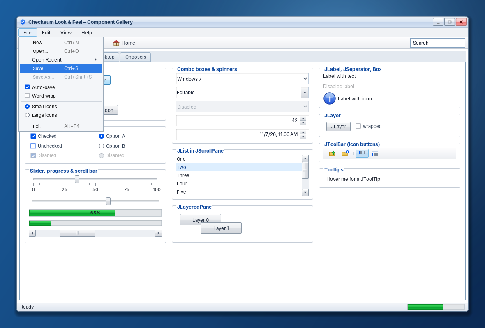
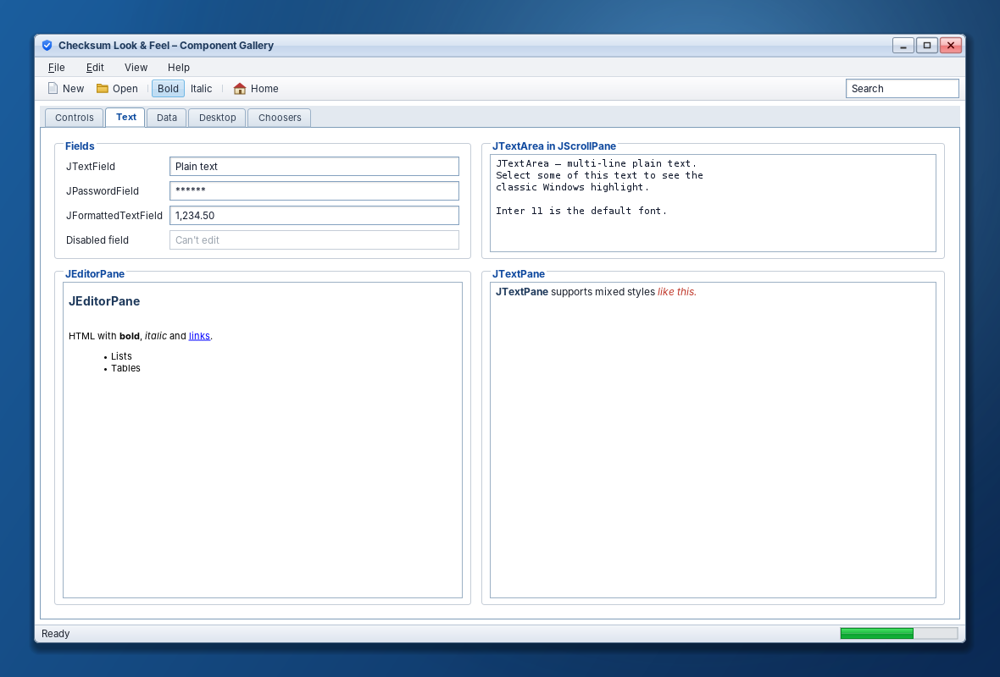
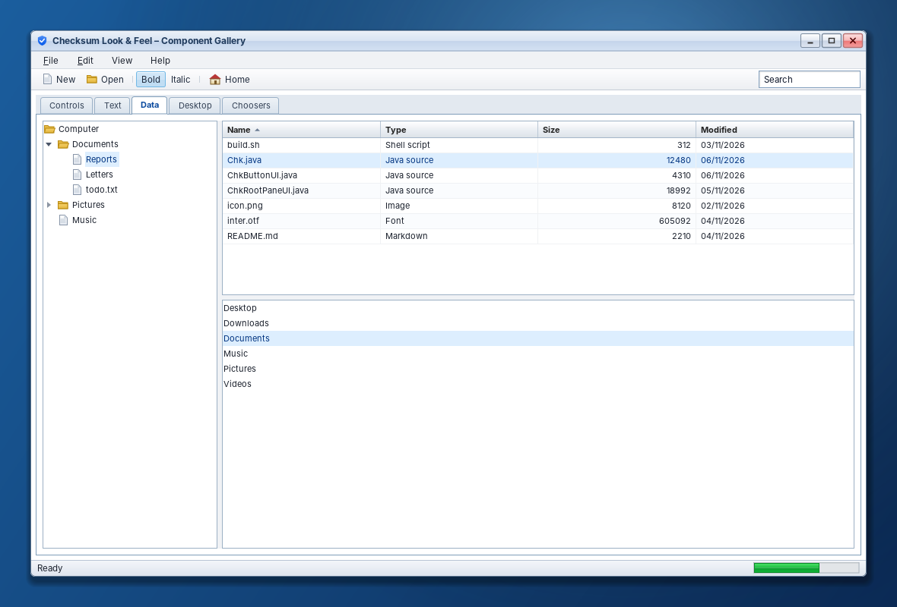
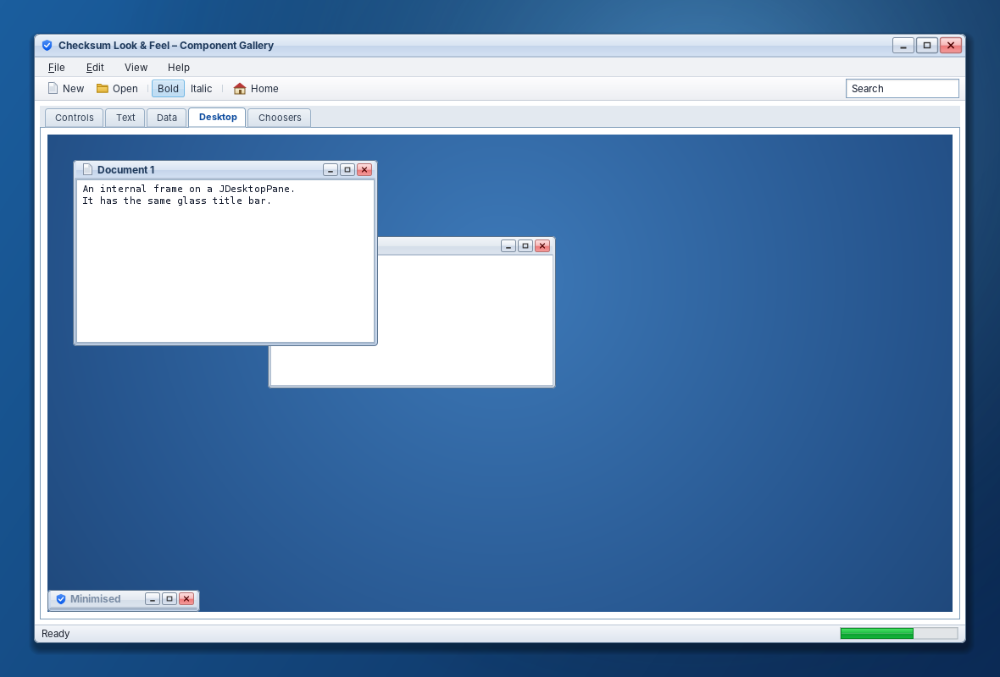

# Checksum LAF - Win 7/Vista Glossy Plastic from CheksumChecker Inspired


## Summary

**Checksum LAF** is a Java Swing **Look and Feel** extracted from the design of the Checksum Checker application. It combines the glossy plastic feel of Windows 7 and Vista into a compact, reusable look for your own Swing applications.


## Development Status

#### Note : Vibe Coded, In-Development - Bugs may exist - Use with caution - Report Bugs and Feature Requirements!!!

  

---

## ❤️ Support This Project

If you enjoy using this software, you can support
its continued development!

### 🍕 Buy Me a Pizza  
<a href="https://buymeacoffee.com/sahasrarachakra?l=en">
  
</a>


## If you are an Indian Supporter
### 🇮🇳 Support via UPI

Scan this QR code using Google Pay, PhonePe or Paytm.


Thank you for supporting open-source development!

---

## Screens








## Features

- Swing Look and Feel derived from the Checksum Checker UI
- Glossy Win 7 / Vista plastic buttons, toolbar and status bar styling
- Custom title bar
- Tab, menu and form control styling that matches the Checksum Checker design
- Smooth text anti-aliasing
- Easy one-line installation

## Prerequisites for Running

- This is a **library for Java developers**, not a stand-alone program
- A Java application (Swing) running on **Java 17 or later**

## How to Run

1. Download the latest `Checksum-LAF.jar` from the **Releases** page.
2. Add it to your application's classpath (or to the `lib/` folder of your IDE project).
3. Install the look and feel before creating any Swing component:

```java
import javax.swing.UIManager;

public class Demo {
    public static void main(String[] args) throws Exception {
        UIManager.setLookAndFeel("com.jsoft.checksumlaf.ChecksumLookAndFeel");
        javax.swing.SwingUtilities.invokeLater(() -> {
            // create and show your JFrame here
        });
    }
}
```

Or start any existing Swing app with it from the command line:

```bash
java -Dswing.defaultlaf=com.jsoft.checksumlaf.ChecksumLookAndFeel -cp Checksum-LAF.jar;yourapp.jar com.example.Main
```

## How to Use

- **Install:** call `UIManager.setLookAndFeel("com.jsoft.checksumlaf.ChecksumLookAndFeel")` once, at startup, before building the UI.
- **Button styles:** select a button style by name using a client property, for example:

```java
ChecksumLookAndFeel.install();            // first line of main(); also enables the custom title bar
```
Run the gallery: `java -jar checksum-laf.jar`.  Rebuild: `./build.sh`.

## Anti-aliasing (on by default)
| What | How |
|---|---|
| Turn everything off, like a plain Java app | `-Dchk.aa=false` or `ChecksumLookAndFeel.setAntialiasing(false, false)` |
| Only shapes / only text | `-Dchk.aa.shapes=false` / `-Dchk.aa.text=false`, or `setAntialiasing(shapes, text)` |
| One component only | `c.putClientProperty("Chk.aa", Boolean.FALSE)` |
Text uses your desktop's setting (ClearType on Windows) when available.

## Window chrome
* JFrame / JDialog / JOptionPane get the 28 px title bar, 1 px #5A738E frame, 26x19 caption buttons.
  Drag to move, double-click to maximise, right-click for the system menu, 5 px resize zone (glass pane).
  Rounded corners need OS per-pixel transparency; otherwise the corners are square.
* Title-bar icon: the window's own icon image, or the built-in shield with `rootPane.putClientProperty("Chk.shieldIcon", true)`.
* JInternalFrame and its minimised JDesktopIcon use the same title bar with small 18x15 buttons; JDesktopPane paints the blue wallpaper.

## Helpers for your app
`ChkBorders.CommandBarBorder` (bottom button bar), `ChkBorders.StatusPaneBorder` (sunken status cells),
`ChkBorders.AccentBorder(color, 2)` (match / mismatch banner), `button.putClientProperty("Chk.style", "primary")`
(blue Verify button), `Chk.monoFont()` / `Chk.baseFont()`, checkbox mixed state: `putClientProperty("Chk.indeterminate", true)`.

## Fonts
See `fonts/README.txt`. Product Sans is proprietary and is not bundled.

```java
button.putClientProperty("JButton.style", "primary"); // primary, standard, error, success ...
```

- **Custom title bar:** enable it with `JFrame.setDefaultLookAndFeelDecorated(true);` before creating your frame.
- **Everything else:** standard Swing components (menus, toolbars, tables, trees, tabs, combo boxes, internal frames, etc.) pick up the look automatically.

<!-- Replace the class name and property keys above with the real ones from your source. -->


## Prerequisites for Building

- **JDK 17 or later**
- An IDE (NetBeans / IntelliJ IDEA / VSCodium) or the command line
- Git

## How to Build

1. Clone the repository:

```bash
git clone https://github.com/SahasraraChakra/Checksum-LAF.git
cd Checksum-LAF
```

2. **Using an IDE:** open the project in NetBeans (or IntelliJ IDEA / VSCodium with Java extensions), make sure the project JDK is 17+, add the libraries from the `lib/` folder to the classpath, then choose **Run / Build**.

3. **Using the command line:**

```bash
# Windows (use ':' instead of ';' on Linux/macOS)
mkdir out
javac -cp "lib/*" -d out -sourcepath src src/com/jsoft/laf/DemoApp.java
jar cfe Checksum-LAF.jar DemoApp -C out .
```

> Adjust the main class and paths above to match your project layout. Copy any resource folders (fonts, images, `.properties` themes) into the output before packaging, if your IDE does not do this automatically.

## Copyright

© JSoft Bharath, Kerala, India & Jeevan Kumar Vishwakarman. All rights reserved.

**Checksum LAF - Win 7/Vista Glossy Plastic from CheksumChecker Inspired Developed By : JSoft Bharath, Kerala, India. / Jeevan Kumar Vishwakarman. All Rights Reserved To : JSoft Bharath, Kerala, India. / Jeevan Kumar Vishwakarman.**

## License

**Attribution-Required, No-Modification, No-Resale License**

Copyright © JSoft Bharath, Kerala, India & Jeevan Kumar Vishwakarman ("the Authors").

Permission is hereby granted, free of charge, to any person or organization obtaining a copy of this software and its source code ("the Software") to **use** the Software, for personal or commercial purposes, subject to the following conditions:

1. **Attribution is compulsory.** Any use of the Software, in any application, product, service, documentation or website, must display the following attribution text, in bold, in a place reasonably visible to users (for example an About dialog, credits screen, README or product page):

   **Checksum LAF - Win 7/Vista Glossy Plastic from CheksumChecker Inspired Developed By : JSoft Bharath, Kerala, India. / Jeevan Kumar Vishwakarman. All Rights Reserved To : JSoft Bharath, Kerala, India. / Jeevan Kumar Vishwakarman.**

2. **No modification.** You may not change, modify, adapt, translate, decompile, reverse-engineer or create derivative works of the Software's code or binaries. The Software must be used exactly as distributed by the Authors.

3. **No selling or charging for the Software.** You may not sell, rent, sublicense, or charge any fee for the Software or its code, in whole or in part, or bundle it in a way that charges for the Software itself. You **may** charge for your own applications, products and services that use the Software, provided the Software itself is not what is being sold and condition 1 is met.

4. **Redistribution.** You may redistribute the unmodified Software free of charge only if this license, the copyright notice and the attribution text are kept intact.

5. **Ownership.** The Software is licensed, not sold. All rights not expressly granted are reserved by the Authors.

6. **Termination.** Any breach of these terms automatically terminates your rights under this license.

THE SOFTWARE IS PROVIDED "AS IS", WITHOUT WARRANTY OF ANY KIND, EXPRESS OR IMPLIED, INCLUDING BUT NOT LIMITED TO THE WARRANTIES OF MERCHANTABILITY, FITNESS FOR A PARTICULAR PURPOSE AND NONINFRINGEMENT. IN NO EVENT SHALL THE AUTHORS BE LIABLE FOR ANY CLAIM, DAMAGES OR OTHER LIABILITY, WHETHER IN AN ACTION OF CONTRACT, TORT OR OTHERWISE, ARISING FROM, OUT OF OR IN CONNECTION WITH THE SOFTWARE OR THE USE OR OTHER DEALINGS IN THE SOFTWARE.

For permission requests beyond these terms, contact the Authors via the repository's Issues page.
