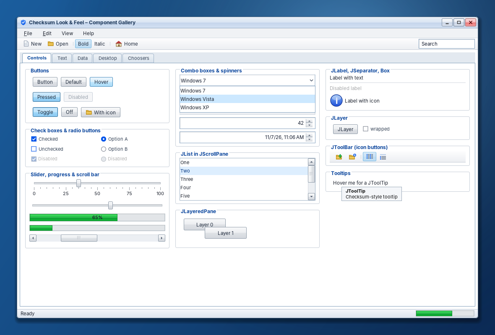
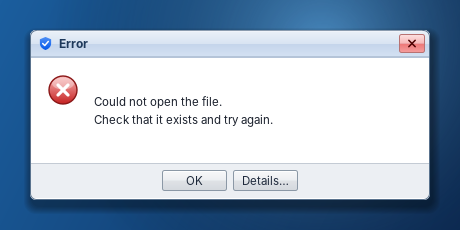
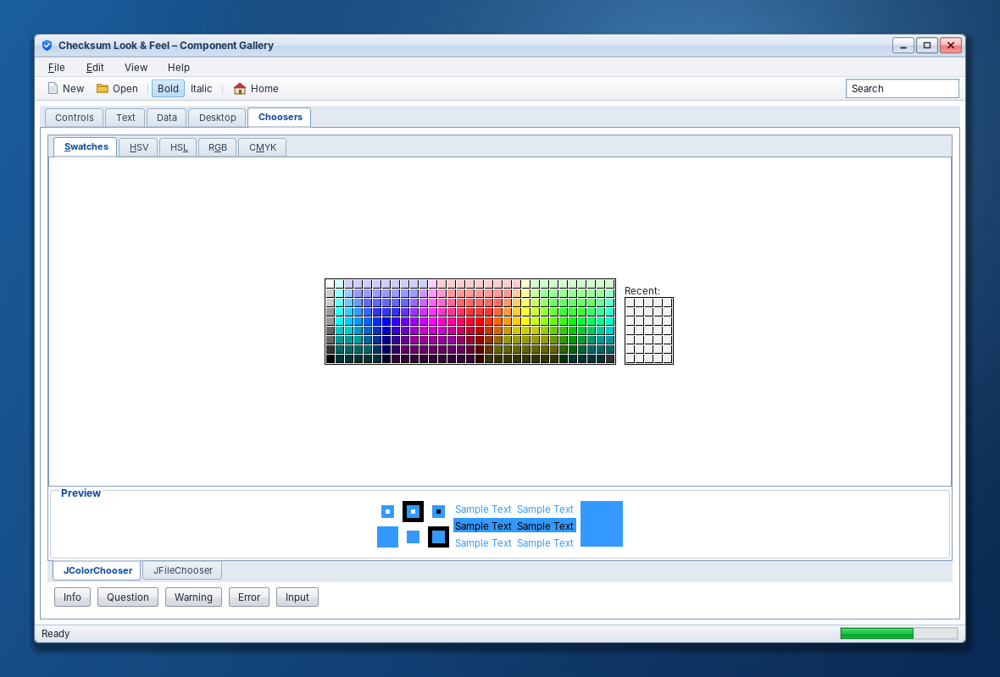

# Checksum Look & Feel (hash-checker mock-up)  / Win 7/Vista Glossy Plastic Look and Feel for Swing
## based on looks of Checksum Validator

#### Important Note : Purely AI coded. Bugs and Errors may exist. Please use with caution !!!

## Screens







```java
ChecksumLookAndFeel.install();            // first line of main(); also enables the custom title bar
```
Run the gallery: `java -jar checksum-laf.jar`.  Rebuild: `./build.sh`.

## Anti-aliasing (on by default)
| What | How |
|---|---|
| Turn everything off, like a plain Java app | `-Dchk.aa=false` or `ChecksumLookAndFeel.setAntialiasing(false, false)` |
| Only shapes / only text | `-Dchk.aa.shapes=false` / `-Dchk.aa.text=false`, or `setAntialiasing(shapes, text)` |
| One component only | `c.putClientProperty("Chk.aa", Boolean.FALSE)` |
Text uses your desktop's setting (ClearType on Windows) when available.

## Window chrome
* JFrame / JDialog / JOptionPane get the 28 px title bar, 1 px #5A738E frame, 26x19 caption buttons.
  Drag to move, double-click to maximise, right-click for the system menu, 5 px resize zone (glass pane).
  Rounded corners need OS per-pixel transparency; otherwise the corners are square.
* Title-bar icon: the window's own icon image, or the built-in shield with `rootPane.putClientProperty("Chk.shieldIcon", true)`.
* JInternalFrame and its minimised JDesktopIcon use the same title bar with small 18x15 buttons; JDesktopPane paints the blue wallpaper.

## Helpers for your app
`ChkBorders.CommandBarBorder` (bottom button bar), `ChkBorders.StatusPaneBorder` (sunken status cells),
`ChkBorders.AccentBorder(color, 2)` (match / mismatch banner), `button.putClientProperty("Chk.style", "primary")`
(blue Verify button), `Chk.monoFont()` / `Chk.baseFont()`, checkbox mixed state: `putClientProperty("Chk.indeterminate", true)`.

## Fonts
See `fonts/README.txt`. Product Sans is proprietary and is not bundled.
